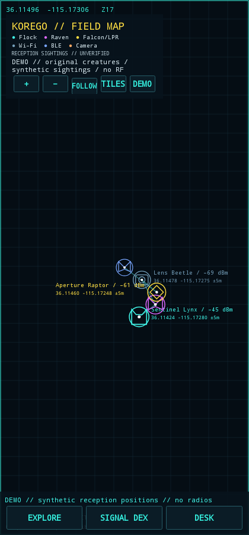
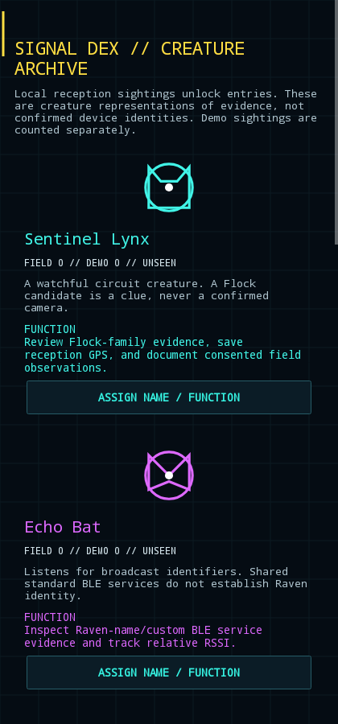

# KoreGo

An original, local RF exploration game for consent-based DEF CON training. Walk or ride through an authorized setting, observe Wi-Fi/BLE signals, and build a **Signal Dex** of creature representations. Detection is evidence, not verified camera identity. No network breaking, deauthentication, packet injection, password attacks, or handshake capture is reachable from the Android app.

## First build: 0.1

- Full-screen integrated, north-up GPS map with pan/pinch/zoom and Follow. Map and dots share the same projection, so pings stay aligned as the view moves. Street tiles are optional and require disclosure/approval.
- Flock, Raven, Falcon/LPR and other camera candidates remain priorities. Dots represent strongest reception / captured phone positions. RSSI controls strength labels and glyph size, never an invented distance or radio bearing. Nearby dots cluster with a chooser for individual sightings.
- Seven original circuit creatures: Sentinel Lynx, Echo Bat, Aperture Raptor, Lens Beetle, Neon Wisp, Cipher Moth, and Static Sprite. **Signal Dex** stores sightings, editable names and function descriptions; field/demo progress stays separate. A ping's field-note page can assign a creature without changing its detector evidence. Edit `headunit/app/src/main/assets/creatures.json` for future designs; artwork/behavior plugins are future work.
- **Explore** approves foreground reception and optional standard Wi-Fi scan requests every 30 seconds. Android can throttle them; this is a cadence of requests, not a scan-completion guarantee. Approval is audited, and Stop, foreground exit, Lock now, or the one-hour PIN expiry stop discovery.
- A built-in **Demo** produces only synthetic sightings and never starts radios. Creature collection has no connected attacks, action rewards, or network-entry requirements.
- Private GPS/photo/nickname/notes, SAF/SD destination selector, full session exports, and Dex JSON export. App ID `com.eidolon.korego` installs separately from Persephone and uses separate private storage/permissions/PIN.
- Optional external overlay contains only the compact legend, dots, RSSI, and coordinates. Other apps' Maps camera state is unavailable; that overlay still needs manual flat-map calibration and pauses/expires. The integrated map is the main navigation view.

## Start

1. Open **KoreGo**. Initial PIN is **9818**; **Desk → System** lets you set a personal PIN. It is required for active standard Wi-Fi refresh and connected training.
2. **Demo** previews the map/Dex without radio use. **Explore** requests Android permissions and then requires session approval; tap again after permission setup.
3. **Tiles** explicitly enables an OpenStreetMap street basemap for this foreground visit. OSM receives your IP/map tile area; no device records are uploaded. Missing Internet leaves the local grid/coordinates usable. Follow needs a fresh, real GPS fix outdoors.
4. Tap a ping/cluster for evidence and field notes. **Signal Dex** lets you customize species names/functions. Descriptions do not enable executable radio capabilities.
5. **Desk → Logs** chooses an SD/save folder and exports sessions/photos. Dex export uses that chosen folder. Private recovery copies remain when media fails.

Positions are receiver/phone coordinates, not measured transmitter locations. A displayed geographic bearing points **to recorded reception** and requires a fresh phone fix outside the position uncertainty. Phone movement course is GPS-derived when moving; this is a 2D map, not camera AR or hardware RF direction finding. The field desk retains the guarded stationary-source RSSI model, whose output is a search hypothesis, not triangulation.

Sightings are deduplicated by local radio/address/species keys with a 4,096-entry progress index. At capacity, new progress stops counting; recorded sessions and current pings continue. Mutable/randomized/spoofed identifiers mean counts are sightings, not proven physical-device counts. A session's bounded 512-ping index preserves annotated entries. This is a functional starter, not a complete location game: quests, creature animations/art imports, multiplayer, and permission-reviewed behavior plugins are future work.

## Build / provenance

See [Android build, passive USB receiver, permissions, storage and evidence documentation](headunit/README.md). Java 17+, Android SDK 35, Gradle 8.9. Run `headunit/test-core.sh`, `headunit/test-firmware.sh`, then `cd headunit && ./gradlew testDebugUnitTest lintDebug assembleDebug`.

Derived from [H34THEN/oui-spy-w4tch3r](https://github.com/H34THEN/oui-spy-w4tch3r), including the verified Persephone refresh/overlay commit `62f1ccd`. GitHub returned Eidolon's existing fork for that repository network, so KoreGo is a separate GitHub repository preserving upstream Git history and attribution. The original project README is retained as [UPSTREAM_README.md](UPSTREAM_README.md); the archived Flutter/robot sources are not Android app dependencies. The APK uses only the receive-only receiver profiles under `headunit/receiver`.

Native synthetic previews (no RF / online map fetch):

